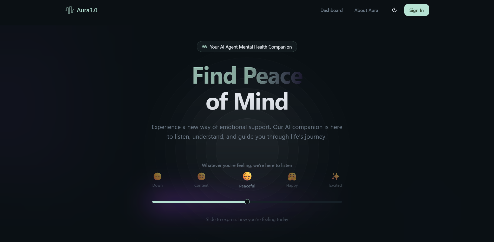
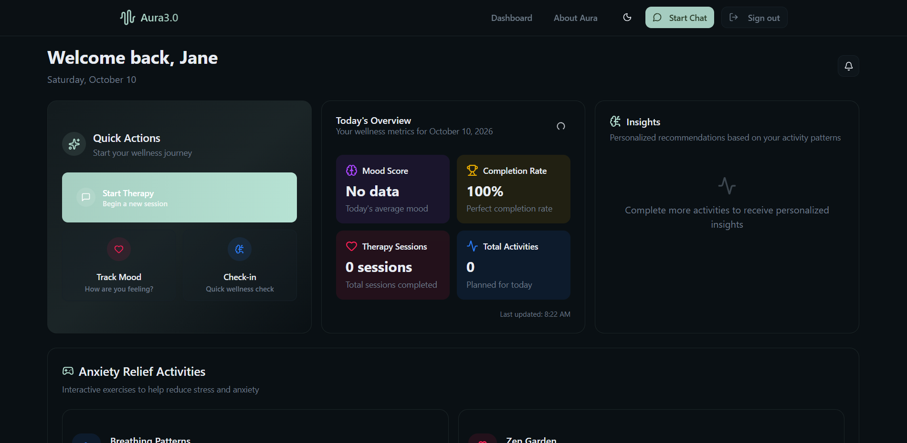
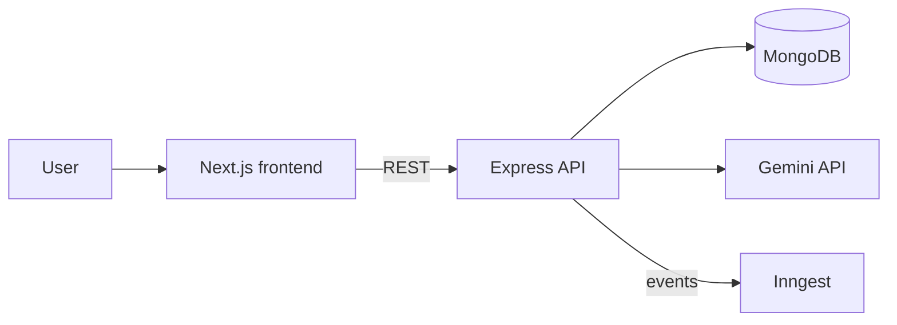

# AI Therapist Agent

A full-stack AI therapy-support app. Users chat with an AI assistant, log how they feel, and track daily wellness activities. Built with Next.js, an Express + TypeScript API, MongoDB, and Google Gemini.

> **Note:** This is a portfolio project. It is not a medical product and does not replace professional mental-health care.

**Live demo:** https://ai-therapist-agent-mea.vercel.app




## Features

- **Accounts and auth:** register, log in, and log out. Passwords are hashed with bcrypt and sessions use JWTs that expire after 24 hours.
- **AI chat sessions:** create sessions, send messages, and review message history.
- **Message analysis:** each message is analysed by Gemini into structured JSON (emotional state, themes, risk level, recommended approach, progress indicators) before a reply is generated.
- **Mood tracking:** log your mood with a slider.
- **Activity tracking:** log wellness activities by type and see today's activities.
- **Dashboard:** mood, activities, and therapy sessions in one place.
- **Protected API:** chat, mood, and activity routes all require authentication.

## How a chat message is handled

1. The frontend sends the message to `POST /api/chat/sessions/:sessionId/messages`.
2. The API publishes an event to Inngest (used for logging and analytics).
3. Gemini analyses the message and returns structured JSON.
4. A second Gemini call generates the reply, using that analysis plus the user's memory and goals.
5. Both messages are saved to the chat session in MongoDB, with the analysis stored as metadata.

## Architecture



## Tech stack

| Area               | Technologies                                                                                   |
| ------------------ | ---------------------------------------------------------------------------------------------- |
| Frontend           | Next.js (App Router), React, TypeScript, Tailwind CSS, Radix UI, Framer Motion, react-markdown |
| Backend            | Node.js, Express, TypeScript, Mongoose                                                         |
| Database           | MongoDB                                                                                        |
| AI                 | Google Gemini (`@google/generative-ai`)                                                        |
| Auth and security  | JWT, bcrypt, Helmet, CORS                                                                      |
| Events             | Inngest                                                                                        |
| Logging            | Winston, Morgan                                                                                |
| Hosting (frontend) | Vercel                                                                                         |

## API overview

All routes are prefixed with `/api`.

| Method | Route                                | Auth | Purpose                            |
| ------ | ------------------------------------ | ---- | ---------------------------------- |
| POST   | `/auth/register`                     | No   | Create an account                  |
| POST   | `/auth/login`                        | No   | Log in and receive a JWT           |
| POST   | `/auth/logout`                       | Yes  | Log out                            |
| GET    | `/auth/me`                           | Yes  | Get the current user               |
| POST   | `/chat/sessions`                     | Yes  | Create a chat session              |
| GET    | `/chat/sessions`                     | Yes  | List chat sessions                 |
| GET    | `/chat/sessions/:sessionId`          | Yes  | Get one session                    |
| POST   | `/chat/sessions/:sessionId/messages` | Yes  | Send a message and get an AI reply |
| GET    | `/chat/sessions/:sessionId/history`  | Yes  | Get message history                |
| POST   | `/mood`                              | Yes  | Log a mood                         |
| POST   | `/activity`                          | Yes  | Log an activity                    |
| GET    | `/activity/today`                    | Yes  | Get today's activities             |
| ANY    | `/inngest`                           | n/a  | Inngest function endpoint          |

## Getting started

### Prerequisites

- Node.js (a current LTS version) and npm
- A MongoDB database (MongoDB Atlas or a local instance)
- A Google Gemini API key

### 1. Clone the repo

```bash
git clone https://github.com/Chiazamoku-Amadi/ai-therapist-agent.git
cd ai-therapist-agent
```

### 2. Run the backend

```bash
cd backend
npm install
```

Create `backend/.env`:

```env
PORT=3001
MONGODB_URI=your-mongodb-connection-string
JWT_SECRET=a-long-random-string
GEMINI_API_KEY=your-gemini-api-key
GEMINI_MODEL=gemini-3.8-flash   # optional, this is the default in the code
NODE_ENV=development            # lets Inngest run locally without an event key
# INNGEST_EVENT_KEY=...         # only needed in production
```

`JWT_SECRET` is required. The server will not start without it.

```bash
npm run dev
```

The API runs at http://localhost:3001.

### 3. Run the frontend

From the repo root, in a new terminal:

```bash
npm install
npm run dev
```

The app runs at http://localhost:3000. It calls the API at `http://localhost:3001` by default. To point it somewhere else, create `.env.local`:

```env
NEXT_PUBLIC_BACKEND_API_URL=http://localhost:3001
```

### 4. (Optional) Run the Inngest dev server

With the backend running:

```bash
npx --ignore-scripts=false inngest-cli@latest dev -u http://localhost:3001/api/inngest
```

The Inngest dev UI opens at http://localhost:8288.

## Scripts

| Location   | Command                       | What it does                             |
| ---------- | ----------------------------- | ---------------------------------------- |
| Root       | `npm run dev`                 | Start the Next.js dev server (Turbopack) |
| Root       | `npm run build` / `npm start` | Production build and start               |
| Root       | `npm run lint`                | Lint the frontend                        |
| `backend/` | `npm run dev`                 | Start the API with nodemon and ts-node   |
| `backend/` | `npm run build`               | Compile TypeScript to `dist/`            |
| `backend/` | `npm start`                   | Run the compiled API                     |

## Project structure

```
.
├── app/            # Next.js routes (landing, login, signup, dashboard, therapy sessions)
├── components/     # UI components (mood form, activity logger, shared UI)
├── lib/            # API client helpers and session context
├── public/         # Static assets
└── backend/
    └── src/
        ├── config/       # Environment config
        ├── controllers/  # Route handlers (auth, chat, mood, activity)
        ├── inngest/      # Inngest client and functions
        ├── middleware/   # Auth and error handling
        ├── models/       # Mongoose models (User, Session, ChatSession, Mood, Activity)
        ├── routes/       # Express routers
        └── utils/        # Database connection and logger
```

## Project status

- Inngest is wired in: the chat flow publishes events and handlers for session, mood, and activity events are registered. The handlers currently log and return placeholder data, and the real logic is still to be built.
- There are no automated tests yet.
